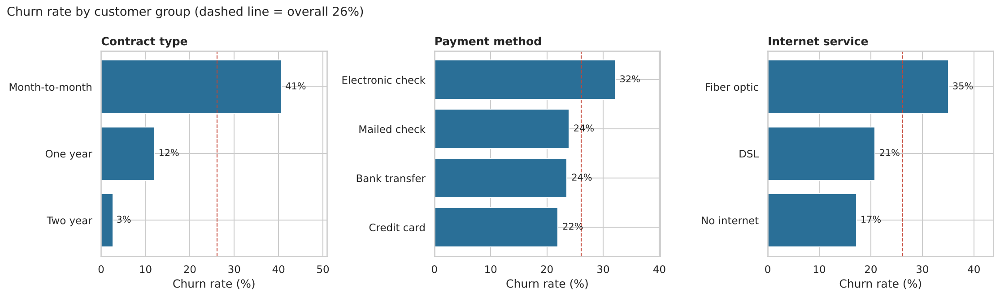
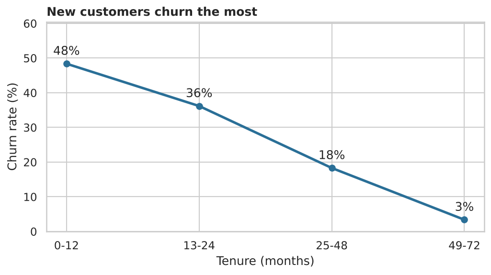
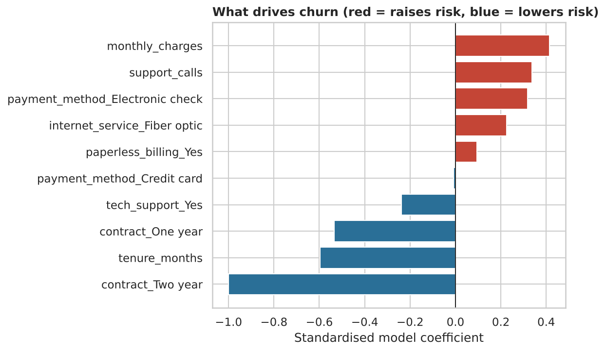

# Customer Churn Analysis

Why do telecom customers leave, and who is likely to leave next?
This project uses **SQL, Python and Power BI** to find the main drivers of churn across 7,000 customers and score every customer by churn risk, giving the retention team a focused call list.



## Key findings

| Finding | Evidence |
| --- | --- |
| Overall churn is **26.1%** (1,827 of 7,000 customers) | SQL query 1 |
| Month-to-month customers churn at **40.7%** vs **2.6%** on two-year contracts | SQL query 2 |
| Customers in their first year churn at **48.4%**; after 4 years only **3.4%** | SQL query 3 |
| Electronic-check payers churn at **32.1%**, about 10 points above other methods | SQL query 4 |
| Fibre customers account for **71%** of monthly revenue lost to churn | SQL query 5 |
| Month-to-month + first year + electronic check: **59.8%** churn (470 customers) | SQL query 6 |
| Churn rises from **19%** (0 support calls) to **43%** (5 calls) | SQL query 7 |



## Churn risk model

A logistic regression scores each customer's probability of churning.

| Model | ROC-AUC |
| --- | --- |
| Logistic regression (chosen, easy to explain) | 0.83 |
| Random forest (comparison) | 0.81 |

| Risk level | Customers | Actual churn |
| --- | --- | --- |
| High | 662 | 70% |
| Medium | 2,067 | 43% |
| Low | 4,271 | 11% |



## Recommendations
1. **Move month-to-month customers to annual plans** with a discount or bonus data.
2. **Onboarding programme** with check-in calls at months 1, 3 and 6, since year one is the danger zone.
3. **Promote auto-pay** (card or bank transfer) over electronic checks.
4. **Proactive follow-up** for any customer with 3+ support calls.
5. **Bundle tech support** into fibre plans, as it is linked to lower churn.

## Tools
- **SQL (SQLite):** aggregations, CASE, CTEs, window functions — [`sql/churn_queries.sql`](sql/churn_queries.sql)
- **Python:** pandas, Matplotlib, Seaborn, scikit-learn — [`notebooks/churn_analysis.ipynb`](notebooks/churn_analysis.ipynb)
- **Power BI:** dashboard built from the scored data — [`dashboard/powerbi_guide.md`](dashboard/powerbi_guide.md)

## Project structure
```
customer-churn-analysis/
├── data/
│   ├── telco_customers.csv      # raw data (7,000 customers)
│   └── customers_scored.csv     # output with churn risk scores
├── notebooks/churn_analysis.ipynb
├── sql/churn_queries.sql
├── scripts/generate_data.py
├── dashboard/powerbi_guide.md
├── images/
└── requirements.txt
```

## How to run
```bash
pip install -r requirements.txt
jupyter notebook notebooks/churn_analysis.ipynb
```

## About the data
The dataset is **synthetic**: it was generated by `scripts/generate_data.py` to mirror the structure and patterns of public telecom churn datasets, so no real customer data is used. To work with real data, swap in the [IBM Telco Customer Churn dataset on Kaggle](https://www.kaggle.com/datasets/blastchar/telco-customer-churn) and adjust the column names.

## Author
**[Your Name]** — Data Analyst · [LinkedIn](https://linkedin.com/in/yourname) · [Email](mailto:you@email.com)
